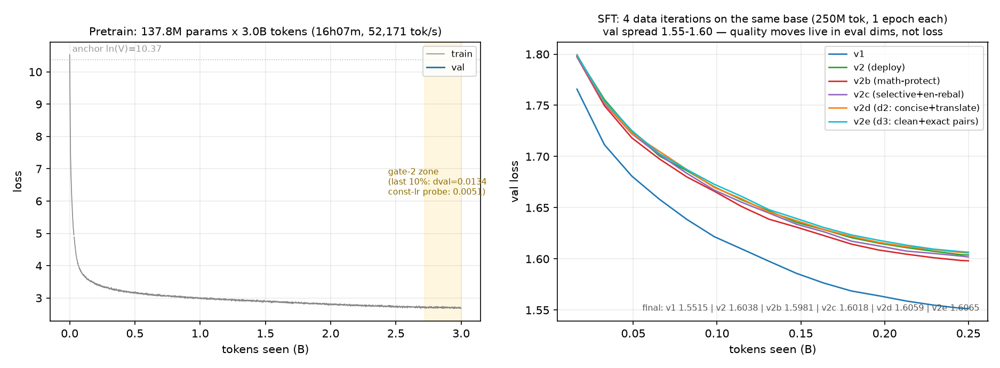

# 从零训练一个 140M 中英小模型 — 10 天全流程报告（草稿）

> 状态：**草稿**（Day 8 起稿并回填 v2c；Day 10 定稿；机动窗口可补充 LoRA 深化/DPO 章节）
> 本报告面向"完整经历一次小模型全生命周期"的复盘叙事：设定 → 数据 → 预训练 → SFT 数据三轮迭代 → 评测 → LoRA 对比 → 部署 → 成本 → 经验。
> 证据链：`reports/`（每次 run 三分 = 摘要 md + 曲线 csv + 原始 log，只增不改）· 决策记录 = [PLAN.md](PLAN.md)（D-01~D-10）· 逐日记账 = [LAB_NOTEBOOK.md](LAB_NOTEBOOK.md)。

## 0. 成绩单（TL;DR）

| 项 | 结果 |
|---|---|
| 模型 | **137,847,552 参数**（d768/L16/H12，RoPE+RMSNorm+SwiGLU+tied embeddings），全手写 PyTorch |
| 预训练 | 3.0B token（中 40% / 英 60%）· 16h07m41s · 52,171 tok/s · val **2.7709** · 0 尖峰 0 中断 · 单卡 RTX 5070 Ti 16GB |
| 吞吐门① | 140M 探针 **52,250 tok/s ≥ 35k**（超 49%），预注册口径跑前未改 |
| 加训门② | 最后 10% val 降幅 0.0134 + 恒定 lr 探针 0.0051 → **不加训**（双证据） |
| SFT | 250M token / assistant-only mask / 1 epoch ≈1h20m × 6 版；**v2e（部署）**：**val 1.6065、rep-4 0.055（全系最低）、题库 17/18（去污后干净读数）、math 8/42 真泛化、translate 真译文**；v2/v2b/v2c/v2d 为过程消融（§4.2~§4.5），v1 为基线 |
| LoRA | r=8（1.20% 可训练）· 峰值显存 **9.74GB（−2.3GB）** · ckpt 526MB+adapter 6.5MB · 1 epoch 欠拟合（val 1.8253） |
| 部署 | **v2e-q8（Q8_0 173MB，2026-11-20 切换）** · Ollama 11435 · 本地聊天页 7860 · GPU 推理 ~910–1,434 tok/s |
| 成本 | 全本地：电费 ~¥4–5/天 + 磁盘 ~120GB；GPU 累计 ~25h（§8 细账） |

**一句话结论**：16GB 消费级显卡上 10 天，从 tokenizer 到可对话 demo 的完整闭环是可行的；决定最终质量的不是训练技巧，而是 **SFT 数据的五轮迭代**（§4）——每轮都由"评测暴露缺陷 → 侦察归因 → 数据侧修复 → 单变量对照"驱动；而比所有单版读数更重要的一条是**评测集去重**（§5.1）：不配去重的"修复"会把指标变成记忆测试。

**八版评测对比**（Day 8 + 机动窗口，同 val / 同 18 题题库 / 统一 greedy；**v2e 起为去污后的干净读数**；详见 §4.4~§4.6 与 `reports/2026-11-20-day8-eval.md` · `...-v2d-eval.md` · `...-v2e-eval.md`）：

| 版本 | SFT val | 预训练 PPL | 题库 | rubric /8 | rep-4 ↓ | distinct-2 ↑ |
|---|---|---|---|---|---|---|
| base（预训练） | — | 15.350 | 6/18 | 1 | 0.727 | 0.232 |
| SFT v1 | 1.5515 | 16.307 | 16/18 | 1 | 0.131 | 0.730 |
| **SFT v2（部署）** | 1.6038 | 16.185 | 15/18 | 4 | **0.066** | **0.854** |
| SFT v2b（消融） | 1.5981 | 16.186 | 15/18 | 5 | 0.117 | 0.807 |
| LoRA r=8（消融） | 1.8253 | **15.690** | 15/18 | 4 | 0.260 | 0.623 |
| SFT v2c（消融） | 1.6018 | 16.184 | **17/18** | 5 | 0.135 | 0.799 |
| SFT v2d（消融，机动） | 1.6059 | 16.181 | 15/18（语义 17/18） | **6** | 0.084 | 0.830 |
| **SFT v2e（机动第 2 轮，去污）** | 1.6065 | 16.192 | **17/18（干净）** | **6** | **0.055（全系最低）** | **0.860** |

读法：①rep-4/distinct-2 与题库分必须并排看（§4.4 的教训）；②**注意读数污染**——v2~v2d 的题库分含评测记忆成分（§4.6 开工发现：extras 与 18 题原句撞车），v1 的 16/18 与 v2e 的 17/18 才是干净读数；③v2e 五项预注册判据全过且全面优于部署版 v2（rep-4/题库/math/en-fluency 全胜），部署切换待拍板。

## 1. 项目设定

- **目标**（学习导向）：10 天假期内从零手写并训练 ~140M 中英小模型（预训练 → SFT → LoRA 对比 → 部署 demo）+ 训练报告。产出 = 经验 + 模型 + 报告 + demo，**非对标开源质量**（140M/3B ≈ GPT-2 124M 水平：通顺、知识贫乏）。
- **硬件**：RTX 5070 Ti 16GB（Blackwell sm_120）/ 96GB RAM / 2TB SSD，全本地执行（D-09）；云端备选仅当本地栈硬性失败。
- **关键决策**（D-01~D-10，详见 PLAN §3）：140M 主模型 · decoder-only 现代配置 · 32k 中英 BPE · 3B token（≈21.8× 参数，Chinchilla 20× 附近）· 序列 1024 · uv 托管 venv（50 系必须 cu128）· 手写 SFT 循环为主（"10 天后能脱稿复述整个训练循环"）。
- **执行方式**：coding agent 陪跑 + 三份元文档（PLAN 决策 / HANDOFF 交接 / LAB_NOTEBOOK 记账）+ 每晚三道概念检验题。

## 2. 数据与 tokenizer（Day 0~2）

- **tokenizer**：32k ByteLevel BPE，specials `<|endoftext|>`/`<|im_start|>`/`<|im_end|>`；留出压缩率 zh **1.841** / en **4.226** chars/token（对 minimind-6400 同文 0.72×/0.70×）；训练 ~4.5min，峰值 RSS ~22GB（BPE 成本按语料词数放大，不按字节线性）。
- **语料**：FineWeb-Edu sample-10BT（英）+ minimind pretrain_t2t（中），轻量清洗（长度过滤 + blake2b 精确去重 en 0.68%）；**3,000,000,000 token**（en:zh = 60:40，token 级缺口调度，偏差 <0.01%）打包 6×1GB memmap 分片 + val 4M（文档级留出 hash%500），全部 sha256 落 `SHA256SUMS`。
- **两个关键纪律**：①值域断言前置数据侧（表外字符穿透 Day 1 的教训：O(秒) 检查抵 O(小时) 排查）；②建库前算"库存/需求比"（zh 3B 已耗库存 72%，加训预案先算账）。

## 3. 预训练：140M × 3B（Day 3~4）

### 3.1 吞吐与门①

| 配置 | 读数 |
|---|---|
| 50M 冒烟（bs16×accum4） | 120,517 tok/s · val 3.6377 |
| **140M 探针（bs8×accum8×T1024）** | **52,250 tok/s · 峰值 10.51GB** → **门① PASS**（≥35k，超 49%） |
| 3B 单程 | 预估 15.9h → 实际 16h07m41s（开销 0.96%） |

**门①口径教训**：原文"≥3.5 万 token/s"未指明模型——50M 的 35k ≈ 140M 的 13k（差 2.74× FLOPs），直接放行会让 3B 实际要 64h。**指标不注明测量对象 = 没定义**；加 140M 20~30 步探针（1~2 min）是最便宜的真值。

**micro-bs 教训**：140M 上 bs8（52,250）> bs10（51,230）> bs16+grad-ckpt（40,449）——16GB 卡上先算 loss 的 fp32 副本（`positions × vocab × 6 bytes`，bs16×1024×32k ≈5.25GB），梯度累积摊不薄它；"更大 batch 更快"必须同口径 ≥40 步实测裁决。torch.compile 在 sm_120 上慢 13×（4,077 tok/s），弃用。

### 3.2 主训练与 loss 曲线（csv = `reports/2026-11-19-day4-main140m.csv`）

| step | token | val loss | 备注 |
|---|---|---|---|
| 0 | 0 | 10.5431（anchor） | ln(32000)+0.170 ✓（容差随规模放宽：22M +0.06 → 140M +0.17） |
| 500 | 33M | 4.9742 | 早期曲线是凸的——探针 40 步外推 500 步会差 1.6 倍，**外推必须按 token 数并注明区间** |
| 4,000 | 262M | 3.3932 | |
| 20,000 | 1.31B | 2.9936 | "中国的首都是巴黎" → |
| 32,000 | 2.10B | 2.8576 | |
| **45,777** | **3.0B** | **2.7709** | "中国的首都是北京" / "The capital of France is Paris" ✓ |

- 16h07m41s 一次跑完：0 尖峰（2,289 窗口）/ 0 OOM / 0 中断；92 次 eval + 22 次采样 + 46 次 ckpt 开销仅 9m17s（0.96%）。46 ckpt 谱系 ≈73GB（G2 要求）。
- train 2.677 vs val 2.7709（gap 0.094，无过拟合）；末段每 500 步 −0.0009。
- **门②（加训判定）= 不触发**：预注册量"最后 10% 降幅 0.0134 < 0.02~0.03"+ 混杂诊断"恒定 lr 探针 300 步仅 0.0051（且是重置 Adam 动量的乐观上界）"——两条独立证据同向。**趋势判定要配混杂诊断**（区分"lr 退火"与"数据饱和"），单口径不可判。



左：主训练曲线（anchor ln(V)=10.37 锚定、门② 判定区间高亮）。右：同底座同预算下 v1/v2/v2b/v2c/v2d/v2e 六版 val 曲线几乎重合（final 1.55~1.61，同 step 差 ≤0.005）——**四轮数据迭代的质量收益在评测维度，不在 loss 维度**（§4）。图 = `tools/plot_loss.py`（素材 = 各 run 的证据 csv）。

## 4. SFT 数据的五轮迭代（Day 5~8 + 机动窗口）★ 本报告的核心章节

SFT 本身只有 ~1h20m（250M token / assistant-only mask / 25% 预训练块混入 / 1 epoch / lr 1e-4）。**真正的故事在数据**：四版数据、每组只改采样规则、同一底座同一评测——把"数据侧修复"的假设-实验-结论链完整记录。

### 4.0 底座读数与评测协议

- SFT v1（`data/sft-mix/`，404,210 会话）：val **1.5515** · 题库 **6/18 → 16/18** · SFT PPL 9.82→4.60 · 预训练 PPL 15.35→16.31（遗忘 +6.2%）。
- 评测协议（Day 6 定档）：**统一 greedy + 关键词判分 + distinct-2/rep-4 退化指标 + 人工 rubric**，18 题/9 tag 题库；解码参数是质量变量，demo 端（T0.7/top-p0.9）单独声明不混对比表。

### 4.1 v1 → 三个质性缺陷（Day 5）

规则判分 89%，但质性复核 ~60%：①"文化、艺术、交通"复读环（罗列癖）；②问 2027 世界杯编造细节（校准缺失）；③"只回答数字"给长篇解释（格式跟随弱）+ en-fluency 触发拒答模板。**规则分会系统性高估质量**（关键词只测"是否提到"）。

### 4.2 解码对照先归因（Day 6）

greedy rep-4 0.131 vs 采样 0.123——**"greedy 放大复读"证伪**；rp1.3 能压到 0.032 但题库 16→13（"用事实换多样性"）。结论：复读来自数据罗列风格，**修复走数据侧，不许用解码调参替代数据修复**。

### 4.3 v2 / v2b（Day 7）：一对镜像消融

| 版本 | 改动 | val | rep-4 | 数学 | 代价 |
|---|---|---|---|---|---|
| v2 | 校准注入 1,630×3 + 格式样本 989×2 + **列表类保留 1/5** | 1.6038 | **0.066** | **回归**（3+5=15、7×6=72） | 列表 9.33% |
| v2b | v2 + **数学样本全量豁免列表降采样** | 1.5981 | 0.117 | **修回**（8、42） | translate/capability 回归 |

**镜像结论**：列表降采样压住了复读（0.131→0.066）也砍掉了数学（长数学推理恰好都是编号步骤）；全量豁免修回数学但把复读抬回来（0.117）。**"表面格式"与"能力域"在同一批样本上冲突**——数据决策没有免费午餐，只有显式取舍。

另一条教训：会话级 grep 高估数据供给（"列表类 28.5%"实为 assistant 侧 34.2%；"只回答"1,703 实为 46）——**数据决策前必须 assistant 侧分类统计**。

### 4.4 v2c（Day 8）：选择性保护 + 英文正例/拒答再平衡

**侦察先行**（assistant 侧，905,718 行全库）：

| 池 | 大小 | 口径 |
|---|---|---|
| 英文正例 | 118,063 条（listy 6,460） | user+assistant 均英文（中文字符 <5%）且无拒答模板 |
| 英文拒答 | 21,345 条（95% 非列表） | 命中 EN_REFUSAL_RE（"I can't/cannot/unable…"） |
| 数学列表 | 26,184 条 | is_math ∧ ≥5 编号行；按**等式行**分布：eqrows≥3 = 9,693 条 |

**三条规则**（`build_sft_v2.py` 新参数，v2 其余不变）：

1. **选择性数学保护** `--protect-math-short`：只豁免 assistant 等式行 ≥3 的数学列表（等式密集的练习列表才教算术组合；叙述型数学罗列不豁免）→ 预期列表占比 9.33% ↔ 13.53% 之间（实际 **10.55%**）。
2. **英文拒答降采样** `--en-refusal-keep-den 2`：训练集内保留 1/2（分支置于 calib 之前——CALIB_RE 英文部分与之重叠，v2 里 "I can't provide…" 模板被当校准保留正是泄漏源）。
3. **英文正例上采样** `--en-helpful-upsample 5`：hash 1/5 选中 → 2×（写入 32,754 条 ≥2,000 判据）。

对账备注：英文拒答全库 21,345 条中 16,601 条集中在 rows 800k-900k 桶，主数据流预算 250M 在 n_read≈810k 截断 → 训练集内 seen 4,722、砍 2,383/留 2,339（**训练集内拒答密度 ~1.16% → 0.40%**；效果等价，因为训练集只由读到的行构成）。

**构建读数**：250,001,408 token / 244,142 blocks（与 v1/v2 完全同预算）· 监督占比 76.16% · mask 段级自检 300 块 2,966 段 **0 违规** · 指纹 4 条入库。

**预注册判据**（跑前不改）：math-add/math-mul 正确且纯数字 · rep-4 <0.08 · en-fluency 不再拒答 · 题库 ≥16/18 · 预训练 PPL 退化 ≤10%。

**结果**（val **1.6018** / 1h19m40s / 52,925 tok/s；六版评测见 `reports/2026-11-20-day8-eval.md`）：

| 指标 | v2（部署） | v2b（消融） | **v2c** | 判据 |
|---|---|---|---|---|
| SFT val | 1.6038 | 1.5981 | **1.6018** | — |
| 题库（关键词 / rubric 8 题） | 15/18 · 4/8 | 15/18 · 5/8 | **17/18 · 5/8（双历史最高）** | ≥16/18 ✓ |
| rep-4 | 0.066 | 0.117 | **0.135** | <0.08 ✗ |
| math-add / math-mul | 15 ❌ / 72 ❌ | 8 ✓ / 42 ✓ | **8 ✓ / 42 ✓**（非纯数字 ⚠️） | 半达 |
| en-fluency | 拒答 ❌ | 拒答 ❌ | **英文正文 ✓✅（四版全挂题首次修复）** | 达 |
| refuse-unknown | rubric ✓ / 关键词 ✗ | rubric ✓ / 关键词 ✗ | **双过 ✓✅** | — |
| translate-en2zh | ✓✅ | ❌ 英答英 | **❌ 英答英（回归）** | — |
| 预训练 PPL | 16.185（+5.4%） | 16.186 | **16.184（+5.4%）** | ≤10% ✓ |

**v2c 的三条结论**：①"只保等式练习列表"就足以修回算术（豁免量 23,253→6,243，数学照样修回）——能力保护的粒度可以比 v2b 细得多；②**修复会翻开新伤口**：en-fluency 不再拒答后英文长文复读暴露（该题 rep-4 0.708）、translate 方向回归——英文上采样把"敢说英文"提上来，也把"长文复读"和"英答英"提上来；③数据构成变化（列表 9.33%→10.55%、会话 404k→587k）对 val 几乎无扰动（同 step 差 0.0013），**质性缺陷的迁移发生在评测维度，不在 loss 维度**。

**裁决（按预注册）**：rep-4 未过 → **部署保持 v2**；v2c 入档为能力最优消融，Day 9 机动方向 = v2d（压长答案复读 + 修 translate 方向）。

### 4.5 v2d（机动窗口，2026-11-20）：长答案压制 + translate 方向 + 格式补强

**侦察先行**（两轮，口径 = build 主数据流 + 前 810k 行预算截断）：复读三题的题型 = **引导型短 prompt**（介绍一下 2,102 条 p50 614 字符 / 如果-怎样 59,303 条 p50 329 / tell me about 122 条 p50 683）——长答案先验超出 140M 长文连贯能力；**英文长答案（≥1000 字符）在前 810k 行写入 0 条**（英文复读 = 中文长答案先验的跨语言泛化，砍不到、只能加正例）；**英→中池仅 608 条（0.22%）** vs v2c 英→英上采样 32,754 条（方向先验被淹没）。

**四规则**（v2c 全部沿用）：①`--long-answer-keep-den 2` 引导型长答案保留 1/2（seen 12,803 → 砍 6,507 / 留 6,296）；②`--translate-upsample 3` 英→中非列表样本 3×（写入 2,106）；③`--concise-repeat 3` 新增 concise 正例（50 条 ×3：中文介绍/假设 + **英文 fluency 组**，2~3 句无编号行）；④`--format-repeat 3`。

**结果**（val 1.6059 / 1h19m44s / 52,851 tok/s；七版评测见 `reports/2026-11-20-v2d-eval.md`）：

| 指标 | v2c | **v2d** | 预注册判据 | 判定 |
|---|---|---|---|---|
| rep-4 | 0.135 | **0.084**（砍 38%） | <0.08 | ✗（差 0.004） |
| 复读三题 rep-4 | reason 0.728 / en-flu 0.708 / zh-flu 0.516 | **0.088 / 0.371 / 0.303** | — | 大幅改善 |
| rubric /8 | 5 | **6（历史最高）** | — | 达 |
| translate-en2zh | 英答英 ❌ | 英答中·字词解释（rubric ✓ / 关键词 ✗） | 恢复 | 半 |
| 题库 | 17/18 | 15/18（两题假阴 → 语义 17/18） | ≥16/18 | ✗（语义达） |
| math-add / math-mul | 8 ✓ / 42 ✓ | **8 ✓ 纯数字** / **72 ✗** | 8/42 | 半 |
| 预训练 PPL | 16.184 | 16.181（+5.4%） | ≤10% | ✓ |

**裁决（按预注册）**：rep-4 差 0.004 + math-mul 回退 → **不切换部署（v2 保持）**；v2d 入档"复读修复最有效 + rubric 最高"的消融版。

**三条新教训**（详见 §9/lessons）：①**组合记忆在容量边缘**——数学豁免量不变、仅净增 2.3M 杂样，7×6 就从 42 退回 72（= 6×12 强先验干扰），单题修复的稳定性要用多版小扰动验证；②**方向池上采样教不会指令行为**——英→中杂样只泛化"英 prompt 中文回应"，输出变成"英文原句 + 中文字词解释"；修指令行为要造"指令 + 直接答案"的精确对；③**修好 translate 行为，rep-4 大概率自然 <0.08**（该题 rep-4 0.293 是 v2d 超过 v2 的最大单项）——v2e 第 2 轮的改动面已由这两条教训定位（translate 精确样本 + math 专项重复 + en_flu 型不上采样）。

### 4.6 v2e（机动窗口第 2 轮）：评测污染的去污与验证

**开工发现**：核对 18 题原句 vs extras 时发现**系统性同题样本**——calibration 的"请告诉我 2027 年世界杯的冠军。"= refuse-unknown 原句、ARITH 模板生成的"7 乘以 6 等于多少？只回答数字。"= math-mul 原句、format brevity/one_sentence 覆盖 fact-water/fact-capital-cn/def-ml、list3 覆盖 list-3、helpful 覆盖 reason，v2d 的 concise 又覆盖 en-fluency/zh-fluency。**后果：v2~v2d 的题库分含记忆成分；v1（无 extras）的 16/18 反而是相对干净的读数。**"按评测缺陷造数据"本身是有效修复手段，但必须做评测集去重，否则指标退化为记忆测试。

**五项改动**：①**去污**（12 处同型变体：换年份/数字/知识点/场景，模板与行为信号保留）+ 构建硬断言 `assert_no_eval_leak`（extras 原句 norm 后不得与题库 prompt 互相包含，撞车即 AssertionError）；②`translate.jsonl` **精确指令对** 30 条（英→中 15 + 中→英 15、指令+直接译文）×6 = 180 条；③数学豁免 ×2（6,250→12,500 写入）；④en_flu 型长答案不上采样（770 条 2×→1×）；⑤v2d 其余沿用。

**结果**（val 1.6065 / 1h19m19s / 53,098 tok/s）：

| 指标 | v2（部署） | v2d | **v2e（去污后）** | 判据 | 判定 |
|---|---|---|---|---|---|
| rep-4 | 0.066 | 0.084 | **0.055（全系最低）** | <0.08 | ✅ |
| 题库关键词 | 15/18（含记忆） | 15/18 | **17/18（干净）** | ≥16 | ✅ |
| translate-en2zh | ✓"我喜爱…" | 字词解释 ❌ | **✓"我热爱机器学习。"** | 恢复 | ✅ |
| math-add / mul | 15 / 72 ❌ | 8 / 72 | **8 / 42（真泛化）** | 8/42 | ✅ |
| en-fluency | 拒答 ❌ | 0.371 | **英文正文（rep4 0.208）** | — | ✅ |
| 预训练 PPL | 16.185 | 16.181 | 16.192（+5.5%） | ≤10% | ✅ |
| rubric /8 · distinct-2 | 4 · 0.854 | 6 · 0.830 | **6 · 0.860（最高）** | — | — |

**五项预注册判据全过（首个）**，且全面优于 v2。**核心洞察**：去污后 math-mul 的 42、refuse 的"没有冠军"、translate 的"我热爱机器学习"都是**无记忆样本下的泛化**——说明 v2 时代的部分"能力不足"是记忆假象，真正的修复机制是数学豁免 ×2（组合曝光）+ 精确指令对（行为样本）+ 长答案压制（复读先验）。**部署切换 v2e 待拍板**（对外可见动作，需重导 GGUF + 联动 Ollama/demo/模型卡）。

## 5. 评测：规则分会骗人（Day 5~7）

- **关键词判分同时有假阴/假阳**：v2 正确回答"2027 年没有世界杯"因 `expect_any` 缺"没有"被判 ❌；v1"没有官方…1958"含"没有官方"会命中、实际在编造。修法 = rubric 同时要求"承认不知道/纠正前提"**且**"无编造年份"；关键词分与语义分并列，不互相替代。
- **退化指标必报**：distinct-2 / rep-4 把"复读 + 拒答模板"从高分里揪出来；repetition penalty 是"用事实换多样性"的交易，要画权衡曲线（rp1.1→0.087/15 分、rp1.3→0.032/13 分）。
- **证据 CSV 的 schema 也要验收**：表头 5 列 vs 行 8 列 → rubric 按 DictReader 静默读错列、整表为空。写完 CSV 做 `head -1` + 行字段数断言。
- **单次温度采样不能做数据归因**：v2 训练中采样说"通义千问"，精确 prompt 统计 82.7% 是 MiniMind——身份/风格是随机变量，用固定解码或统计口径。
- **"按评测缺陷造数据"必须配评测集去重**（v2e 开工发现）：v2 起为修缺陷造的 extras 直接引用了评测原句（2027 世界杯 / 7×6 / 水的化学式…），使题库分含记忆成分。**修复数据要按"能力/行为"写（同型变体），不能按"题目"写**；构建侧加 `assert_no_eval_leak` 硬断言；报告要标注哪些版本的读数是"含记忆"的（v2~v2d）与哪些是干净的（v1、v2e）。

### 5.1 评测集污染（v2e 开工发现与去污）★ 方法学

SFT 数据的每轮"修复"都是按评测暴露的缺陷造的补充样本（`data/sft-extra-v2/`）——**造着造着就把评测原句带进了训练集**：

| 评测题 | 撞车样本（引入版本） | 后果 |
|---|---|---|
| refuse-unknown "2027 世界杯冠军" | calibration **完全一致**（v2 起） | v2~v2d 的 refuse "过" = 记忆原题 |
| math-mul "7 乘以 6…只回答数字" | format ARITH 模板生成原句（v2 起） | math 42 的修复 = 部分记忆 |
| fact-water / fact-capital-cn / list-3 / def-ml / reason | format brevity/list3/one_sentence、helpful（v2 起） | 对应题"过"含记忆 |
| en-fluency / zh-fluency | concise 原句/近句（v2d 起） | v2d 三题复读改善含记忆成分 |

**结论：v2~v2d 的题库分含记忆成分；v1 的 16/18 与 v2e 的 17/18 才是干净读数。**

**修法（v2e）**：①造数据按"能力/行为"写同型变体（换年份/数字/知识点/场景），不按"题目"写；②构建侧硬断言 `assert_no_eval_leak()`——extras 的 user 原句 norm 后不得与 `data/eval/tests.json` prompt 相同或互相包含，撞车即 AssertionError（12 处去污后复扫 0 撞车）；③报告并列"含记忆/干净"读数并标注版本。

**净化后的证据**：v2e 在无记忆样本下五项判据全过（rep-4 0.055 / 题库 17/18 / math 42 真泛化 / translate "我热爱机器学习。"）——说明真正的修复机制（数学豁免 ×2、精确指令对、长答案压制）**泛化得动**，而记忆样本只能"修指标"。**有评测集的项目，应把"extras vs 测试集去重"做成构建硬门，和"值域断言"同级。**

## 6. LoRA vs 全参（Day 7）

| 维度 | 全参 SFT | LoRA r=8 |
|---|---|---|
| 可训练参数 | 100% | **1.20%**（qkv/proj/gate/up/down） |
| 峰值显存 | 12.05GB | **9.74GB（−2.3GB）** |
| ckpt 体积 | 1.65GB | **526MB + adapter 6.5MB** |
| 速度 | 52,825 tok/s | 54,124 tok/s |
| SFT val | 1.6038 | 1.8253（**1 epoch 欠拟合**） |
| 题库 / rep-4 | 15/18 · 0.066 | 15/18 · **0.260** |
| 预训练遗忘 | +5.4% | **+2.2%（15.690，更少遗忘）** |

**结论**：LoRA 的资源账全胜（显存/磁盘/速度/遗忘），但 1.20% 低秩容量在 1 epoch 内学不会"模板+校准+格式"（同 step 1000：全参 1.7005 vs LoRA 1.8574）；lr 2e-4 欠拟合 → 5e-4 更好。**r=8/1 epoch 的 LoRA 不适合从零小模型的首次 SFT 对齐**，适合领域增量。深化对照（r=12/2 epochs）留机动窗口。

## 7. 部署（Day 7）

- 导出链路：`export_gguf.py`（**q/k 权重必须按 llama.cpp RoPE 布局 permute**——漏掉则"前几词正常、随后复读"，F16/Q4 同病）；导出后 raw GGUF 与 PyTorch greedy 输出对拍一致才算验收——**"能加载/能跑" ≠ "语义对"**。
- 体积：F16 326MB / **Q4_K_M 103MB** / Q8_0 173MB；Ollama 用户级服务（11435，系统服务无模型目录写权限）；聊天页用 stdlib 实现（`app_stdlib.py`，7860；Gradio 镜像下载卡死弃装）。
- GPU demo：Q4 100% GPU / 157MB；identity 21 token 0.023s ≈ 910 tok/s、ML 单句 0.016s ≈ 1,434 tok/s。
- **量化保真度（2026-11-20 v2e 部署发现，★）**：同 prompt/chat 模板/greedy 三档对拍——F16 5/5 逐字一致（链路忠实）；**Q8_0 保住 v2e 新学能力**（math 42 / translate 中文）；**Q4_K_M 把 42 打回 72、translate 打回英文原句**——量化噪声冲掉"弱记忆"（新学能力与基座强先验冲突时先验反扑）。v2 时代"q4 与 PyTorch 一致"只因它的错误答案本身就是强先验。**部署默认因此选 Q8_0（173MB），验收协议 = F16 逐字对拍 + 目标量化的"新学能力抽检"**；细节 `reports/2026-11-20-deploy-v2e.md`。

## 8. 成本核算

| 项 | 用时/体积 | 备注 |
|---|---|---|
| 环境 + 数据下载 | ~0.5 天人力，37.9GB raw | cu128 wheel（50 系硬性）+ hf-mirror |
| tokenizer | 4.5 min | RSS 峰值 22GB |
| 3B 分片构建 | 20.7 min（2.42M tok/s） | |
| 字符级 20M 冒烟 | 96.1 min | 锚定复现 |
| 50M 30min 预注册 + 140M 探针 | ~35 min | 门① 证据 |
| **140M 主训练** | **16h07m41s** | 52,171 tok/s |
| SFT v1 / v2 / v2b / v2c | 各 ~1h20m × 4 | 250M token / 3,815 步 |
| LoRA（2e-4 探针 + 5e-4 全量） | ~1.5h | |
| 评测 + 解码对照 + 门② 探针 | ~1.5h | |
| GGUF 导出 + 部署 + demo | <0.5h | |
| **GPU 累计** | **≈26.1h**（主训练 16.13 + SFT×4 ≈5.31 + LoRA 全量+探针 ≈1.49 + char20m 1.60 + 50M/探针/解码对照/门② ≈1.2 + 评测/导出 ≈0.4） | 电费 ~¥4–5/天（D-09） |
| 磁盘 | raw 37.9GB + shards 6GB + ckpt ~86GB（46+8）+ 数据层 ~10GB | 指纹全入库 |

**预算视角**：全程无云端费用；最大单笔 GPU 支出 = 主训练一夜。若重来一次，Day 0 数据预下载 + Day 3 吞吐门仍是不可省的前置。

## 9. 经验清单（Top 13，全文见 `notes/lessons.md` 跨日回顾）

1. 值域/锚定断言前置数据侧——O(秒) 检查抵 O(小时) 排查。
2. 首步 loss ≈ ln(V) 是免费复现锚，容差随规模放宽（+0.06 → +0.17）。
3. 无人值守跑批五件套：tmux 脱离 + 滚动 ckpt + `--max-minutes` + EXIT 标记 + kill 一次验证续训。
4. 证据三分（md/csv/log）+ 每份落位即录指纹。
5. 显存上限先算 loss 的 fp32 副本（`positions × vocab × 6 bytes`）。
6. 决策门口径写清"在哪个模型、哪段曲线"，配混杂诊断。
7. 优化项一律单变量对照再归因（compile/micro-bs/greedy 三次直觉错）。
8. 质量评估三件套：关键词 + 质性 rubric + 退化指标。
9. SIGPIPE 与 pkill 自匹配——操作安全的两条。
10. 先算库存/需求比再拍数据预算。
11. **采样规则按能力域保护，不按表面格式一刀切**（v2→v2b→v2c 的主线教训）；能力域内还可按"功能特征"再收窄一档（等式行 ≥3 的练习列表才教算术组合，Day 8）。
12. "能加载/能跑" ≠ "语义对"（GGUF permute / CSV schema / 导出对拍）。
13. **降采样/上采样的作用域是"训练集（读到的行）"，不是"全库"——改预算 = 改训练分布**；且修复一个能力域会翻开新伤口，缺陷在评测维度迁移、loss 维度几乎不动（Day 8）。

## 10. 复现

```bash
# 环境（50 系）：uv venv --python=3.12 + torch 2.11.0+cu128，详见 reports/2026-11-18-day0-env-snapshot.md
python tools/train_tokenizer.py                    # 32k BPE
python tools/build_shards.py                       # 3B 分片
python tools/train.py --run-name main140m ...      # 预训练（命令见 reports/2026-11-18-day3-140m-probe.md §6）
python tools/build_sft_v2.py --listy-keep-den 5 --protect-math-short --en-refusal-keep-den 2 \
    --en-helpful-upsample 5 --concise-repeat 3 --translate-upsample 3 --long-answer-keep-den 2 \
    --format-repeat 3 --translate-ex-repeat 6 --math-upsample 2 --en-flu-no-upsample \
    --out-dir data/sft-mix-v2e                     # 最终数据（v2e，含 extras 评测去污断言）
python tools/sft.py --init-from out/main140m/last.pt --data-dir data/sft-mix-v2e --run-name sft-v2e ...  # 见 skill §3.2
python tools/eval.py --ckpt base=out/main140m/last.pt --ckpt v2e=out/sft-v2e/last.pt --out reports/<date>-eval.md
python tools/export_gguf.py --ckpt out/sft-v2e/last.pt --out out/gguf/pretrain-lab-140m-sft-v2e-f16.gguf  # GGUF
ollama create pretrain-lab-sft-v2e-q8 -f out/Modelfile-sft-v2e -q q8_0            # 部署（Q8_0）
python tools/app_stdlib.py --model pretrain-lab-sft-v2e-q8 --port 7860             # demo
```

## 11. 已知限制与下一步

- **限制**：数学弱（v2e 去污后 math 8/42 真泛化，但纯数字格式与 list-3 编号格式仍未跟随）；知识止于语料（2024 前后）；LoRA 1 epoch 欠拟合；部署版是否升级 v2e 待拍板（v2 仍有 en-fluency 拒答与 math 15/72）。
- **下一步**（11-22~27）：部署切换 v2e 拍板（切则重导 GGUF/Ollama/demo/模型卡）；Day 10 最终对比表（八版）+ 报告定稿 + repo 整理；LoRA 深化/DPO 视余力。
