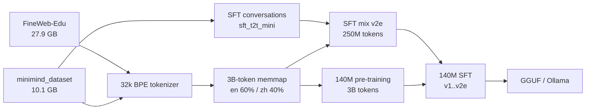

# Architecture

## 1. Model

A decoder-only Transformer implemented in `tools/model.py` with no external
model code (PyTorch only). The implementation is self-contained and
AI-assisted; the design decisions and evaluation were human-directed.

| Item | Value |
|---|---|
| Parameters | **137,847,552** |
| d_model | 768 |
| Layers | 16 |
| Heads | 12 (head_dim 64) |
| FFN | SwiGLU, hidden = 2048 (8/3·d rounded to multiple_of 64) |
| Norm | RMSNorm (pre-norm), eps 1e-6 |
| Position | RoPE, theta 10000, half-split layout |
| Embeddings | tied input/output embeddings |
| Vocab | 32,000 BPE (ByteLevel) |
| Context | 1024 tokens |
| Bias | none |
| Attention | PyTorch SDPA with `is_causal=True` |

Special tokens: `<|endoftext|>` = 0, `<|im_start|>` = 1, `<|im_end|>` = 2.
Chat template:

```
<|im_start|>user
{content}<|im_end|>
<|im_start|>assistant
{content}<|im_end|>
```

At inference, append `<|im_start|>assistant\n` and generate until
`<|endoftext|>` or the token limit.

## 2. Data pipeline



- Pre-training: 3,000,000,000 tokens, English 60% / Chinese 40%,
  uint16 memmap, six 1 GB shards + 4M validation tokens.
- SFT: 250,001,408 tokens, 244,142 blocks, assistant-only labels
  (`ignore_index=-100` for user/system tokens), 25% pre-training blocks
  mixed in to reduce forgetting.
- The SFT mixture includes synthetic calibration/format/helpfulness/
  conciseness/translation samples (`data/sft-extra-v2/`), with an
  evaluation-leak assertion at build time.

## 3. Pre-training recipe

| Item | Value |
|---|---|
| Tokens per step | 8 × 8 × 1024 = 65,536 |
| Total steps | 45,777 |
| Optimizer | AdamW (fused), β=(0.9, 0.95) |
| LR | 6e-4, warmup 500, cosine to 10% |
| Weight decay | 0.1 |
| Grad clip | 1.0 |
| Precision | bf16 autocast, fp32 master weights |
| Throughput | ~52,171 tok/s |
| Wall clock | 16h07m41s |
| Peak memory | ~10.51 GB |
| Validation | 40 iterations, batch 16, every 500 steps |

The first-step loss anchor is `ln(32000) = 10.3735`; the 140M run started
at +0.17. A value above +0.5 or near 0 indicates a data/vocab/batching
problem.

## 4. SFT recipe

| Item | Value |
|---|---|
| Tokens | 250,001,408 |
| Steps | 3,815 |
| Batch | 8 × 8 × 1024 |
| LR | 1e-4, warmup 100, cosine |
| Precision | bf16 |
| Peak memory | ~12.05 GB |
| Wall clock | ~1h19m |
| Mask | assistant tokens only |
| Variants | v1, v2, v2b, v2c, v2d, v2e |

The six SFT variants are data ablations, not hyperparameter sweeps:

- v1: clean baseline.
- v2: calibration/format/translation fixes, list downsampling; math regressed.
- v2b: full math protection; repetition rose.
- v2c: selective math protection (equation rows ≥3), English rebalancing.
- v2d: long-answer repetition suppression, translation direction, concise positives.
- v2e: evaluation decontamination, exact translation instruction pairs, math ×2;
  deployed (2 known dev residues).

## 5. LoRA

| Item | r=8 | r=12 | r=12, 2 epochs |
|---|---|---|---|
| Trainable | 1.20% | 1.79% | 1.79% |
| Targets | qkv, proj, gate, up, down | same | same |
| Alpha | 16 | 16 | 16 |
| Peak memory | 9.74 GB | 9.76 GB | 9.76 GB |
| SFT val | 1.8253 | 1.8054 | **1.7921** |
| Holdout 90 manual | 43 | 42 | 48 |

LoRA is not deployed: rank and epochs each buy only −0.020 / −0.013
validation loss, leaving a 0.19 gap to full fine-tuning. It is suitable for
domain increments, not first alignment.

## 6. Export formats

| Format | Script | Use |
|---|---|---|
| PyTorch `.pt` | training checkpoints | `eval.py`, exact reproduction |
| HF Llama | `tools/export_hf.py` | `transformers` inference |
| GGUF F16 | `tools/export_gguf.py` | Ollama/llama.cpp, fidelity reference |
| GGUF Q8_0 | `ollama create -q q8_0` or `llama-quantize` | deployment default |
| GGUF Q4_K_M | `ollama create -q q4_K_M` | **not faithful for v2e** (math/translation lost) |

The GGUF export applies the llama.cpp q/k permutation
(`[n_head, 2, head_dim/2, in] → swapaxes(1,2)`). Without it, RoPE sees
misaligned q/k and the model repeats after a few tokens.

## 7. Code map

| File | Role |
|---|---|
| `tools/model.py` | model definition (RoPE/RMSNorm/SwiGLU/tied embeddings) |
| `tools/train.py` | pre-training loop (shards, accumulation, resume, sampling) |
| `tools/sft.py` | full-parameter SFT + LoRA |
| `tools/lora.py` | LoRA A/B + apply/merge |
| `tools/build_shards.py` | tokenize + memmap shards |
| `tools/train_tokenizer.py` | 32k BPE |
| `tools/build_sft_v2.py` | SFT mixture builder (v2..v2e) |
| `tools/gen_sft_v2_extra.py` | synthetic extras (calibration/format/translation) |
| `tools/eval.py` | dev/holdout evaluation, PPL, distinct-2/rep-4 |
| `tools/eval_format.py` | rubric extraction |
| `tools/eval_lang.py` | zh/en split validation |
| `tools/check_eval_leak.py` | three-layer bidirectional dedup |
| `tools/export_gguf.py` | GGUF (q/k permute) |
| `tools/export_hf.py` | HF Llama format |
| `tools/app_stdlib.py` | zero-dependency chat demo |
| `tools/app.py` | optional Gradio demo |